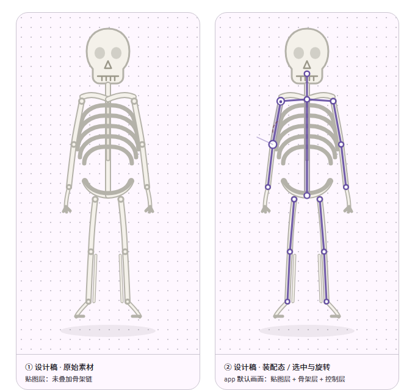
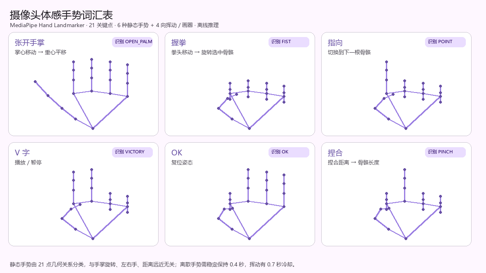

# 2D 骨骼动画编辑器 · HumanSkeleton

基于 Jetpack Compose 的 2D 骨骼动画编辑原型。骨架造型、界面布局、配色与图标严格取自 [UI 设计稿 v1.0](design/2d-skeleton-ui-spec.html) —— 骨架是设计稿中带体积感的部件路径，不是线条占位图。



> 走路循环逐帧预览：[walk-cycle-frames.png](design/walk-cycle-frames.png) · FK 修复前后对比：[skeleton-fk-fix-before-after.png](design/skeleton-fk-fix-before-after.png) · 步态优化对比：[walk-cycle-gait-upgrade.png](design/walk-cycle-gait-upgrade.png) · 前后摆臂对比：[walk-cycle-front-back-arms.png](design/walk-cycle-front-back-arms.png)

## 功能

| 分区 | 内容 |
| --- | --- |
| 装配 | 设计稿骨架（11 个部件组 / 16 段骨骼链 / 15 个关节锚点）、四视图变体、点阵网格、选中光晕、深色画布、贴图与骨架图层开关 |
| 动画 | 24 帧 / 30fps 时间轴、关键帧编辑、循环播放、洋葱皮、录制状态、预览模式 |
| 部件 | 部件面板；从系统相册选图并绑定到骨骼 |
| 权重 | 按切图分组的部件归属着色视图 |
| 工具 | 选择 / 新建骨骼 / 绑定 / IK；单指拖关节旋转、双指缩放平移、长按菜单（重命名、镜像、重置） |
| 面板 | 骨骼层级树、属性滑杆（位置 / 旋转 / 长度）、撤销重做 |
| 顶栏 | 菜单、网格开关、预览、导出（写入 `walk_cycle.json`） |
| 布局 | 平板 1280×800 五区布局（Navigation rail）+ 手机 390×844 竖屏（底部导航） |
| 体感手势 | 前置摄像头 + MediaPipe 手部 21 关键点，识别 11 种手势；预设离散动作 + 连续操控 2D 骨骼（详见下文） |

播放由 `Choreographer.FrameCallback` 对齐 Vsync，帧号计算与 Canvas 绘制解耦；内置 24 帧闭合走路循环：交替抬腿、骨盆与肩带反向扭转、重心起伏。手臂按矢状面「前后」摆动——设计稿骨架是纯正面 2D，没有深度轴，因此用前摆侧屈肘抬手、沿骨轴透视缩短和「近实远虚」的透明度来表达前后，而不是绕肩横向甩动；点播放即持续循环。

## 技术栈

- Kotlin 2.2.10 · Jetpack Compose（BOM 2026.02.01）· Material 3
- AGP 9.4.0 · compileSdk / targetSdk 37 · minSdk 24
- JDK 21（Gradle daemon toolchain 21）
- 原生 `Canvas` / `Paint` + `androidx.core.graphics.PathParser` 绘制设计稿 SVG 路径
- 自实现仿射矩阵 `Mx`，用于正向运动学（FK）、屏幕坐标逆映射与手势旋转
- CameraX 1.3.4 + MediaPipe Tasks Vision 0.10.35（Hand Landmarker，模型随 APK 打包、完全离线推理）

## 摄像头体感手势



**开启方式**：画布右上角点「手势」→ 授权相机 → 点旁边的「?」查看手势表。手掌正对前置摄像头、距离 30–60 cm。开启时会自动暂停走路循环，避免两套动画叠加；V 字手势可随时恢复播放。

**手势定义与映射**

| 类别 | 手势 | 骨骼动作 | 判定依据 |
| --- | --- | --- | --- |
| 连续 | 张开手掌 | 掌心位置 → 重心平移 | 4–5 指伸展 |
| 连续 | 握拳 | 拳头左右移动 → 旋转选中骨骼 | 0–1 指伸展 |
| 连续 | 捏合 | 捏合距离 → 选中骨骼长度 | 拇食指靠近，且其余至少一指伸展 |
| 连续 | 画圈 | 累计转角 → 骨盆 / 脊柱 / 头部旋转 | 质心绕圈累计 ≥ 0.73 圈 |
| 离散 | 指向 | 切换到下一根骨骼 | 仅食指伸展 |
| 离散 | V 字 | 播放 / 暂停 | 食指 + 中指伸展 |
| 离散 | OK | 复位姿态、回到第 0 帧 | 捏合 + 中 / 无名 / 小指伸展 |
| 离散 | 左 / 右挥 | 后退 / 前进一帧 | 质心水平净位移 |
| 离散 | 上 / 下挥 | 抬起 / 放下手臂 | 质心垂直净位移 |

**实现要点**

- 判定全部基于 21 点之间的**距离比值**（指尖 / PIP 相对腕与掌指关节、拇指尖—食指尖 / 手掌尺度），与手掌旋转、左右手、离摄像头远近无关。握拳与捏合靠「其余三指是否伸展」区分，因为攥拳时拇指本来就贴着食指。
- 三层防误触：质心 EMA 平滑、挥动需净位移 + 方向优势 + 700 ms 冷却、离散手势需稳定保持 380 ms 且两次触发间隔 ≥ 900 ms。
- 手势效果写进 `EditorState` 的**覆盖层**（角度 / 长度 / 重心），在 `animatedAt()` 末尾与关键帧、程序步态一起叠加到 FK；不写进 `pose`，因此不进撤销栈，关闭开关或做 OK 即可完全还原。
- 模型 `app/src/main/assets/hand_landmarker.task` 由课程提供，随 APK 打包；`androidResources.noCompress += "task"` 保持未压缩。CPU 推理、约 18 fps 上限，不依赖 Google Play 服务或网络。
- 相机权限运行时申请；无前置摄像头时自动回退后置；无相机设备仍可正常使用其余编辑功能。

**验证与限制**

- 离线用合成 21 点复现分类与轨迹判定，6 种静态手势 + 4 向挥动 + 抖动抑制共 11 项断言全部通过；`assembleDebug --offline` 构建通过，APK 内确认含模型与 4 个 ABI 的 `libmediapipe_tasks_jni.so`。
- 沙箱无真机：摄像头取景、光照适应性、关键点叠加与预览的镜像对齐、连续操控手感，需安装 APK 实测。
- 引入 4 个 ABI 原生库后 Debug APK 约 77 MB；若只需真机部署，可在 `build.gradle.kts` 用 `ndk.abiFilters` 只保留 `arm64-v8a` 以显著减小体积。

## 构建

需要 JDK 21、Android Studio（兼容 AGP 9.4）与 Android SDK Platform 37。项目设置了 `org.gradle.java.installations.auto-download=false`，不会自动下载 JDK，请确保本机已安装 JDK 21 或设置好 `JAVA_HOME`。

```bash
# Windows
gradlew.bat assembleDebug

# macOS / Linux / Git Bash
./gradlew assembleDebug
```

产物：`app/build/outputs/apk/debug/app-debug.apk`

## 目录结构

```
HumanSkeleton/
├── app/src/main/java/com/example/humanskeleton/
│   ├── MainActivity.kt          # 入口
│   ├── art/                     # 设计稿骨架路径、图标、SpecIcon 组件
│   ├── editor/                  # SkeletonCanvas（触摸手势）、SkeletonRenderer（绘制）
│   ├── gesture/                 # 体感手势：分类器、轨迹追踪、YUV 转换、CameraX + MediaPipe 管线
│   ├── model/                   # EditorState、Skeleton（FK / 关键帧）、Transform（Mx）
│   └── ui/                      # EditorScreen、顶栏 / 导航 / 骨骼树 / 属性 / 时间轴、手势面板、theme
├── design/                      # UI 设计稿、演示文档、预览图
├── gradle/                      # wrapper 与版本目录 libs.versions.toml
└── build.gradle.kts / settings.gradle.kts / gradle.properties
```

## 设计资料

| 文件 | 说明 |
| --- | --- |
| `design/2d-skeleton-ui-spec.html` | UI 设计稿 v1.0：配色、图标风格、骨骼人物视觉、平板与手机布局 |
| `design/skeleton-control-demo.html` | 两种控制方式流畅度对比的可运行原型（含实时基准测试） |
| `design/demo-report.html`、`design/output/2d-skeleton-demo/stage3/*.docx` | 演示文档（HTML 版与 Word 交付版） |
| `design/*.png` | 骨架预览、FK 修复前后、走路循环逐帧、手势词汇表 |
| `design/gesture-vocabulary.png` | 6 种静态手势的 21 关键点判定示意（离线算法验证生成，非真机截图） |

HTML 设计稿请用浏览器打开（在 GitHub 上点开只会显示源码）。

## 说明

- `local.properties`、`.idea/`、`build/`、`*.apk` 等已由 `.gitignore` 排除，不入库。
- 导出按钮把当前编辑状态写成 JSON，保存在应用自身的「文档」目录（`walk_cycle.json`）。
- 这是课程演示原型：编辑状态保存在内存中，尚未接入项目文件的持久化与读回。
