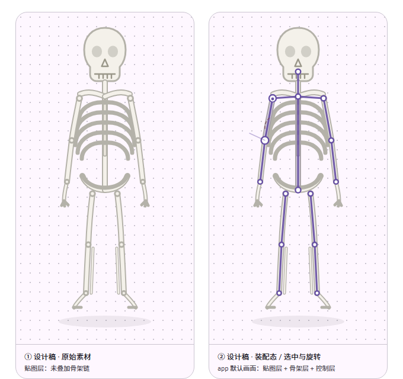

# 2D 骨骼动画编辑器 · HumanSkeleton

基于 Jetpack Compose 的 2D 骨骼动画编辑原型。骨架造型、界面布局、配色与图标严格取自 [UI 设计稿 v1.0](design/2d-skeleton-ui-spec.html) —— 骨架是设计稿中带体积感的部件路径，不是线条占位图。



> 走路循环逐帧预览：[walk-cycle-frames.png](design/walk-cycle-frames.png) · FK 修复前后对比：[skeleton-fk-fix-before-after.png](design/skeleton-fk-fix-before-after.png)

## 功能

| 分区 | 内容 |
| --- | --- |
| 装配 | 设计稿骨架（11 个部件组 / 16 段骨骼链 / 15 个关节锚点）、四视图变体、点阵网格、选中光晕、深色画布、贴图与骨架图层开关 |
| 动画 | 24 帧 / 30fps 时间轴、关键帧编辑、循环播放、洋葱皮、录制状态、预览模式 |
| 部件 | 部件面板；从系统相册选图并绑定到骨骼 |
| 权重 | 按切图分组的部件归属着色视图 |
| 工具 | 选择 / 新建骨骼 / 绑定 / IK；单指拖关节旋转、双指缩放平移、长按菜单（重命名、镜像、重置） |
| 面板 | 骨骼层级树、属性滑杆（位置 / 旋转 / 长度）、撤销重做 |
| 顶栏 | 菜单、网格开关、预览、导出（写入 `walk_cycle.json`） |
| 布局 | 平板 1280×800 五区布局（Navigation rail）+ 手机 390×844 竖屏（底部导航） |

播放由 `Choreographer.FrameCallback` 对齐 Vsync，帧号计算与 Canvas 绘制解耦；内置 24 帧闭合走路循环，交替抬腿配合手臂反相，点播放即持续循环。

## 技术栈

- Kotlin 2.2.10 · Jetpack Compose（BOM 2026.02.01）· Material 3
- AGP 9.4.0 · compileSdk / targetSdk 37 · minSdk 24
- JDK 21（Gradle daemon toolchain 21）
- 原生 `Canvas` / `Paint` + `androidx.core.graphics.PathParser` 绘制设计稿 SVG 路径
- 自实现仿射矩阵 `Mx`，用于正向运动学（FK）、屏幕坐标逆映射与手势旋转

## 构建

需要 JDK 21、Android Studio（兼容 AGP 9.4）与 Android SDK Platform 37。项目设置了 `org.gradle.java.installations.auto-download=false`，不会自动下载 JDK，请确保本机已安装 JDK 21 或设置好 `JAVA_HOME`。

```bash
# Windows
gradlew.bat assembleDebug

# macOS / Linux / Git Bash
./gradlew assembleDebug
```

产物：`app/build/outputs/apk/debug/app-debug.apk`

## 目录结构

```
HumanSkeleton/
├── app/src/main/java/com/example/humanskeleton/
│   ├── MainActivity.kt          # 入口
│   ├── art/                     # 设计稿骨架路径、图标、SpecIcon 组件
│   ├── editor/                  # SkeletonCanvas（手势）、SkeletonRenderer（绘制）
│   ├── model/                   # EditorState、Skeleton（FK / 关键帧）、Transform（Mx）
│   └── ui/                      # EditorScreen、顶栏 / 导航 / 骨骼树 / 属性 / 时间轴、theme
├── design/                      # UI 设计稿、演示文档、预览图
├── gradle/                      # wrapper 与版本目录 libs.versions.toml
└── build.gradle.kts / settings.gradle.kts / gradle.properties
```

## 设计资料

| 文件 | 说明 |
| --- | --- |
| `design/2d-skeleton-ui-spec.html` | UI 设计稿 v1.0：配色、图标风格、骨骼人物视觉、平板与手机布局 |
| `design/skeleton-control-demo.html` | 两种控制方式流畅度对比的可运行原型（含实时基准测试） |
| `design/demo-report.html`、`design/output/2d-skeleton-demo/stage3/*.docx` | 演示文档（HTML 版与 Word 交付版） |
| `design/*.png` | 骨架预览、FK 修复前后、走路循环逐帧 |

HTML 设计稿请用浏览器打开（在 GitHub 上点开只会显示源码）。

## 说明

- `local.properties`、`.idea/`、`build/`、`*.apk` 等已由 `.gitignore` 排除，不入库。
- 导出按钮把当前编辑状态写成 JSON，保存在应用自身的「文档」目录（`walk_cycle.json`）。
- 这是课程演示原型：编辑状态保存在内存中，尚未接入项目文件的持久化与读回。
